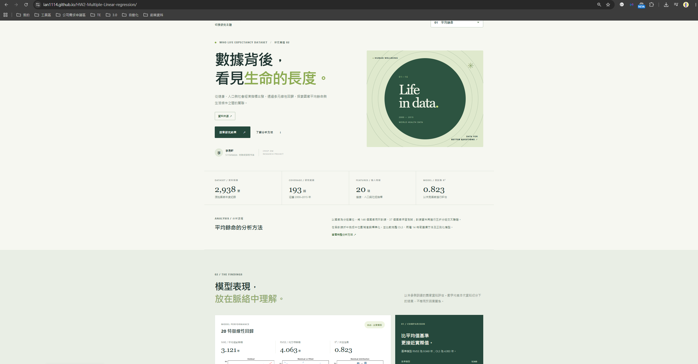

# HW2: Multiple Linear regression

| 項目 | 資訊 |
| --- | --- |
| 課程名稱 | AIoT 與數據分析（AIoT & Data Analytics, AIoT-DA） |
| 課堂實作 | HW2: Multiple Linear regression |
| 授課單元 | AIoT L7 HW 2 Multiple Linear Regression |
| 示範教師 | Huan Chen |
| 儲存庫網址 | [Ian1114/HW2-Multiple-Linear-regression](https://github.com/Ian1114/HW2-Multiple-Linear-regression) |
| Live Demo Page | [線上展示網站](https://ian1114.github.io/HW2-Multiple-Linear-regression/) |



姓名：李易軒｜學號：5115056026

資料：[Life Expectancy (WHO)](https://www.kaggle.com/datasets/kumarajarshi/life-expectancy-who)，本機來源 `dataset/Life Expectancy (WHO)/Life Expectancy Data.csv`，原始檔不修改。研究以 2000–2015 國家年度資料估計同年度平均餘命，並以國家分組評估未見過的國家；不宣稱未來預測或因果關係。

## VS Code 執行

1. 用 VS Code 開啟這個資料夾，選擇 `.venv/Scripts/python.exe` 作為 Python 解譯器。
2. 開啟 `hw2_regression.ipynb`，選同一個 kernel，按「全部執行」。
3. 結果在 `outputs/`，包括指標、兩種方法的特徵名單、圖、模型和資料雜湊；平均餘命報告為 `reports/life_expectancy_report.pdf`。

目前環境為 Windows、Python 3.14.7；相較原設計的 3.11 初始目標已調整。若要重建環境，可安裝 Python 3.14 後執行：

```powershell
python -m venv .venv
.\.venv\Scripts\python.exe -m pip install -r requirements-lock.txt
.\.venv\Scripts\python.exe -m pytest -q
```

新資料預測，輸入應含原始 20 個欄位，Status 為 Developing 或 Developed；可另含 Country 供輸出辨識：

```powershell
.\.venv\Scripts\python.exe -m hw2lib.predict "新資料.csv" "預測結果.csv"
```

模型檔為 pickle 格式，只載入可信任來源的模型。重新執行 Notebook 會覆寫 outputs 的研究結果。若使用其他工作目錄，請先切換到專案根目錄。

## 結果與限制

主模型為 20 特徵 OLS，國家分組 CV RMSE 4.337 年，保留集 MAE 3.121 年、RMSE 4.063 年、R² 0.823。兩個死亡人數欄位的 VIF 很高，且異質變異與同國觀測相依會影響傳統 OLS 推論與區間。

報告包含 GPT 輔助內容與 NotebookLM 摘要；對話紀錄及完整報告 PDF 位於儲存庫根目錄。原始設計與資料集變更紀錄見 `docs/superpowers/specs/`。提交前仍應核對資料授權與教授最新規範。

## 本機網站（前後端）

`.venv` 是專案獨立的 Python 套件環境；`.env` 用於本機設定，兩者用途不同。可複製 `.env.example` 為 `.env`，調整監聽位址、埠號與模型檔路徑；不建立 `.env` 時使用相同預設值。系統環境變數優先，`.env` 不應提交或放入憑證。

```powershell
Copy-Item .env.example .env
.\.venv\Scripts\python.exe -m webapp.server
```

開啟 `http://127.0.0.1:8000`。按 Ctrl+C 停止服務。後端讀取 `outputs/life_expectancy_model.joblib` 進行預測，需保留原始資料集、分析輸出與 PDF 報告。環境變數 `PORT` 可供部署平台指定埠號；公開部署時應依平台設定 `HW2_HOST=0.0.0.0`。Python 服務用於本機執行；公開靜態版位於 https://ian1114.github.io/HW2-Multiple-Linear-regression/ 。

## 三個資料集分頁

網站包含平均餘命、巴黎房價及學生成績三個獨立分頁。巴黎與成績各自以本機 `dataset/` 資料訓練獨立的線性回歸模型：

```powershell
.\.venv\Scripts\python.exe -m webapp.train_datasets
```

巴黎資料為虛構資料；學生資料使用 Kaggle 下載的 `student-por.csv`（葡萄牙語課程）。學生成績模型包含 G1、G2，僅適用已有前期成績的分析。各模型的資料雜湊、切分與測試數值記錄於 `outputs/paris_metadata.json` 和 `outputs/student_metadata.json`。三份資料集各有 CRISP-DM 報告；網站上方的「閱讀完整報告」會隨目前分頁切換。巴黎及學生成績報告包含基準、完整 OLS、兩種 14 特徵方法、殘差診斷與條件式區間。

## 重算補充報告

```powershell
.\.venv\Scripts\python.exe -m reports.analyze_datasets
```

以上指令重算巴黎與學生成績的報告統計及圖表；執行 `reports/build_supplemental_reports.py` 另需 pandas、ReportLab 及 Windows 的標楷體。產出的兩份 PDF 位於 `reports/`。分析報告及網站的完整 OLS 為同一切分與前處理；特徵選擇是補充比較，不會因測試集結果變更網站模型。

## GitHub Pages

網站靜態發布目錄是 `docs/`。GitHub Pages 為靜態網站，因此線上版以匯出的模型係數在瀏覽器內計算；本機版維持 Python 伺服器。更新模型或頁面後執行：

下拉選單提供「自訂資料集」：選擇 UTF-8 CSV、目標與輸入特徵後，可分析資料並移除已選檔案。本機版以 Python 後端運算；GitHub Pages 版在瀏覽器以 Pyodide 載入相同的分析程式執行，CSV 不傳送至伺服器。線上版第一次使用需要網路下載 Python 與分析套件，可能須等待一段時間。CSV 限 8 MB、100,000 列和 200 欄，目標須為連續數值、至少有 20 筆有效資料。不同資料集仍需自行檢查識別碼、資料洩漏和適當的切分方式。

```powershell
.\.venv\Scripts\python.exe -m webapp.build_pages
Copy-Item -Recurse -Force site/* docs/
Copy-Item -Force site/.nojekyll docs/.nojekyll
```

原始 Kaggle 資料未放入此公開儲存庫，請依下列來源及檔名自行下載，並確認各資料集使用與散布條件：

- `dataset/Life Expectancy (WHO)/Life Expectancy Data.csv`：https://www.kaggle.com/datasets/kumarajarshi/life-expectancy-who
- `dataset/Paris Housing Price Prediction/ParisHousing.csv`：https://www.kaggle.com/datasets/mssmartypants/paris-housing-price-prediction
- `dataset/Student Performance Data Set/student-por.csv`：https://www.kaggle.com/datasets/larsen0966/student-performance-data-set
